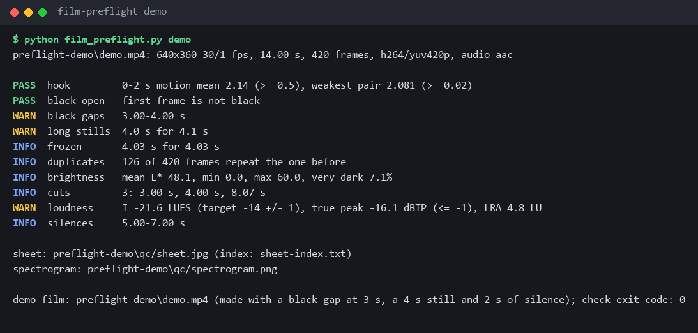
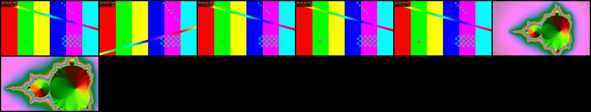
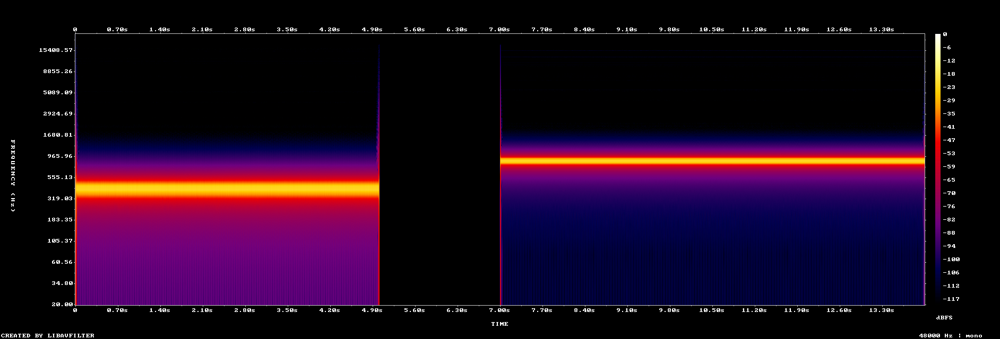

<div align="center">

# film-preflight

**Check any finished video in one ffmpeg pass before you publish it: hook, black frames, freezes, cuts, loudness.**

AI video agents like [cinecode](https://github.com/sarpstar/cinecode) and [video-director](https://github.com/win4r/video-director) now render whole films from code. Somebody still has to catch the frozen shot and the -22 LUFS mix before upload. This does it in one decode instead of ten.

Works with **Claude Code** and **Codex**.

 



</div>

## Install in Claude Code / Codex

```bash
/plugin marketplace add Dodai0419/film-preflight
/plugin install film-preflight@film-preflight
```

Codex: `git clone https://github.com/Dodai0419/film-preflight && cp -r film-preflight/skills/* ~/.codex/skills/`

## Quick start

```bash
git clone https://github.com/Dodai0419/film-preflight && cd film-preflight
python film_preflight.py demo                 # makes a 14 s test film with planted faults and checks it
python film_preflight.py check my-film.mp4    # your own render
```

Needs Python 3.9+ and `ffmpeg`/`ffprobe` on PATH. Nothing to pip install.

```text
preflight-demo\demo.mp4: 640x360 30/1 fps, 14.00 s, 420 frames, h264/yuv420p, audio aac

PASS  hook         0-2 s motion mean 2.14 (>= 0.5), weakest pair 2.081 (>= 0.02)
PASS  black open   first frame is not black
WARN  black gaps   3.00-4.00 s
WARN  long stills  4.0 s for 4.1 s
INFO  frozen       4.03 s for 4.03 s
INFO  duplicates   126 of 420 frames repeat the one before
INFO  brightness   mean L* 48.1, min 0.0, max 60.0, very dark 7.1%
INFO  cuts         3: 3.00 s, 4.00 s, 8.07 s
WARN  loudness     I -21.6 LUFS (target -14 +/- 1), true peak -16.1 dBTP (<= -1), LRA 4.8 LU
INFO  silences     5.00-7.00 s
```

The demo film has a 1 s black gap at 3 s, a 4 s still at 4 s, a cut at 8 s and 2 s of silence at 5 s. Every one of them shows up above.

## What you get

Every run writes these files to `--out` (default: a temp folder named after the video):

| File | What it is |
|------|------------|
| `report.txt` | the PASS / WARN / FAIL / INFO table above |
| `report.json` | the same plus every raw measurement (per-frame motion, black and freeze intervals, cut times, loudness) |
| `sheet.jpg` | contact sheet, one frame every 2 s (`--every`, `--cols`) |
| `sheet-index.txt` | which tile is which timestamp |
| `spectrogram.png` | log-frequency spectrogram of the soundtrack |
| `frames.md5` | one MD5 per decoded frame (how duplicates are found) |

### Contact sheet of the demo film



Read it left to right: the test pattern, the black gap, the frozen frame held for 4 s, then the cut to the fractal.

### Spectrogram of the demo film



The 440 Hz tone, the 2 s gap, then the 880 Hz tone. A persistent horizontal line in a real mix is a pitched layer you did not mean to keep.

## The checks

| Check | Rule | Status if broken | Source of the rule |
|-------|------|------------------|--------------------|
| **hook** | the first 2 s must move from frame 1: mean frame difference >= 0.5, and every pair of steps >= 0.02 (a look drawn on twos still passes) | FAIL | cinecode `qc.py hook` |
| **black open** | the film must not start on black | FAIL | cinecode (no fade from black), video-director (frame 0 check) |
| **black gaps** | black intervals of 0.1 s or more after the start | WARN | cinecode `qc.py black` |
| **long stills** | picture almost unchanged for more than 3 s; more than 10 s usually means the recording broke | WARN / FAIL | vibe-knowledge `qa.py` |
| **frozen** | exact freezes of 1.5 s or more (-60 dB) | INFO | cinecode `qc.py freeze` |
| **duplicates** | consecutive frames with the same MD5 | INFO | cinecode `qc.py dup` |
| **brightness** | mean, min, max L* at 4 samples/s, share of very dark samples (L* < 12) | INFO | cinecode `qc.py bright` |
| **cuts** | hard cuts with scene score > 0.3 | INFO | cinecode `qc.py cuts` |
| **loudness** | EBU R128: integrated -14 +/- 1 LUFS, true peak <= -1 dBTP | WARN | cinecode `qc.py loud`, video-director |
| **silences** | below -50 dB for 0.5 s or more; every silence should be scripted | INFO | cinecode `qc.py loud` |

Exit code: `1` if any check is FAIL, `2` if the file cannot be read, else `0`. An agent can gate an upload on it:

```bash
python film_preflight.py check out/final.mp4 --out qa && echo "ship it"
```

## The problem

- A coded film is rendered headless, so nobody watched it. A frozen browser tab, a black first frame or a silent music bed ships unseen.
- The QC scripts that exist run one ffmpeg command per check. cinecode's `qc.py` decodes the same film about ten times for its basic checks, so a one-minute 720p film costs ~30 s of checking.
- Each studio repo carries its own copy: cinecode has `qc.py`, video-director has `qa_video.py` (numpy + Pillow), vibe-knowledge has `qa.py` (macOS-only OCR and fonts). None of them runs alone on a stock Windows box.

## The solution

| Idea | Fixes |
|------|-------|
| **One decode, many branches** | `split` and `asplit` feed every detector from the same decoded frames, so the film is read once |
| **Same filters, same numbers** | the filter settings are cinecode's, unchanged; a test runs both ways and asserts identical values |
| **Rules from three studios** | cinecode's hook and loudness targets, vibe-knowledge's 3 s / 10 s still rule, video-director's PASS/WARN/FAIL report and exit codes |
| **Stdlib + ffmpeg only** | no numpy, no Pillow, no Swift, no fonts; runs on Windows, macOS and Linux |

## Use with Claude Code

```bash
/plugin marketplace add Dodai0419/film-preflight
/plugin install film-preflight@film-preflight
```

Then ask: "check `out/final.mp4` before we upload it". The skill runs `check`, reads `report.txt`, looks at `sheet.jpg`, and fixes or re-renders anything marked FAIL.

## Use with Codex (ChatGPT)

```bash
git clone https://github.com/Dodai0419/film-preflight && cp -r film-preflight/skills/* ~/.codex/skills/
```

Or copy `AGENTS.md` into your project root.

## Options

```text
python film_preflight.py check <video> [--out DIR] [--every 2] [--cols 6] [--json]
python film_preflight.py demo [--out preflight-demo]
python film_preflight.py bench <video> [-n 3]
```

- `--every` / `--cols`: contact sheet spacing and width.
- `--json`: print `report.json` instead of the table (for agents).
- `bench`: runs the same checks once as separate ffmpeg calls (cinecode's arguments) and once as a single pass, and prints both times.

## Benchmarks

Same checks, same filter settings, same input. "Separate calls" replays cinecode `qc.py`'s ffmpeg and ffprobe commands for hook, info, sheet, black, freeze, dup, bright, cuts, loud and spec, plus vibe-knowledge's still detector, one after another (`separate()` in `film_preflight.py`). Measured with `python film_preflight.py bench <video> -n N`, wall time, median.

| | separate calls (cinecode qc.py style) | film-preflight one pass |
|-|-|-|
| 14 s demo film, 640x360, 5 runs | 4,685 ms | 1,287 ms (3.6x) |
| 60 s test film, 1280x720, 3 runs | 30,350 ms | 9,408 ms (3.2x) |
| ffmpeg/ffprobe processes started | 15 (11 decodes of the film) | 3 (one probe, one tiny drawtext test, one pass) |
| Python dependencies | none | none |
| lines of code | `qc.py` 344 (plus `scene_check.py` 371 for `all`) | 301, including the bench and the demo film |

Machine: Windows 11, Python 3.11, ffmpeg 9.0.2 (gyan.dev full build), CPU busy with other work during the runs, so absolute times vary; the ratio held between 3.2x and 3.6x across runs. Identical values on both paths are asserted in `tests/test_film_preflight.py`.

Not covered: cinecode's per-scene checks (`action`, `sceneloud`, `pops`, `repeats`, `loop`, from `scene_check.py`) and vibe-knowledge's OCR read-back and BGM fingerprint check. Those need more than ffmpeg filters.

## Why this instead of the original scripts

| | cinecode `qc.py` | video-director `qa_video.py` | vibe-knowledge `qa.py` | film-preflight |
|-|-|-|-|-|
| decodes per run | ~10 | several | 3 | 1 |
| runs on Windows out of the box | yes | needs numpy + Pillow | no (Swift OCR, macOS font path) | yes |
| PASS / WARN / FAIL with exit code | hook only | yes | no | yes |
| per-scene and OCR checks | yes | yes (text size, contrast) | yes (OCR) | no |

Use the originals inside those studios. Use this when you want one fast gate for any MP4, from any tool.

## Inspired by

- [sarpstar/cinecode](https://github.com/sarpstar/cinecode) (MIT): every ffmpeg filter setting, the hook rule, the L* formula and the loudness targets.
- [win4r/video-director](https://github.com/win4r/video-director) (MIT): the PASS / WARN / FAIL report, the frame-0 check and the exit-code contract.
- [andyhuo520/vibe-knowledge](https://github.com/andyhuo520/vibe-knowledge) (MIT): the 3 s longest-still rule and the 10 s "the recording broke" alarm.

## Roadmap

- [ ] Per-scene loudness from the same pass (one `ebur128` branch per scene boundary)
- [ ] Planned-cut comparison: `--expect-cuts 4.0,8.0` as in video-director
- [ ] A loop-seam check for looping social clips

## License

MIT. See `LICENSE` and `NOTICE` for the upstream notices.
